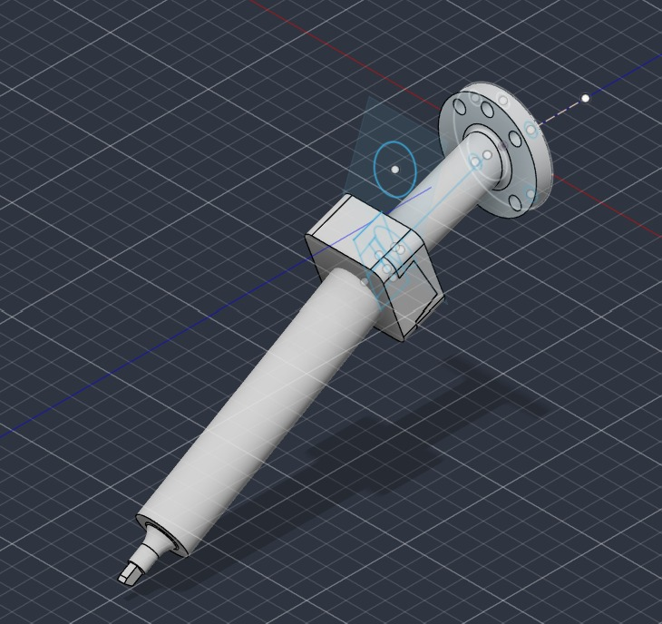
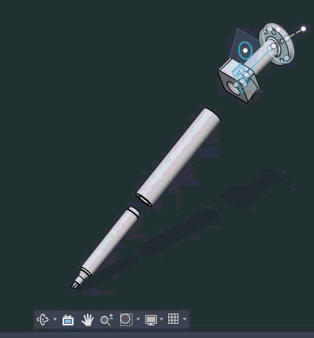

# Herramienta

En esta carpeta se incluirá la información relacionada con la herramienta diseñada para el robot.

Aquí se incluirán:

* **Diseño de la herramienta:** Porta-marcador adaptado al *flange* del robot ABB IRB 140.
  ### Archivos CAD y Modelos 3D

* 📐 **Acople del marcador (Pieza 1):** [`Acople_marcador_Pieza1.step`](./Acople_marcador_Pieza1.step)
* 📐 **Tubo del marcador:** [`Tubo_marcador.step`](./Tubo_marcador.step)
* 📦 **Modelo para RobotStudio:** [`HERRAMIENTA_PARA_SIMULACION.sat`](./HERRAMIENTA_PARA_SIMULACION.sat)
 #### 📸 Vista Previa del Modelo CAD de la herramienta

  
  

#### 📸 Vista Previa del Modelo CAD de la herramienta

  

#### 🎞️ Animación de la herramienta

  

---

### Metodología de Calibración y Análisis de Variabilidad (Real vs. Virtual)

El proceso de calibración del TCP en el robot real se realizó de manera iterativa mediante el método de los 4 puntos en el FlexPendant. En las primeras pruebas se obtuvieron errores elevados (entre el 15% y el 7%), causados por aproximaciones desde ángulos muy parecidos y por la imprecisión visual al alinear la herramienta con el cono de referencia. Siguiendo las recomendaciones del docente y del monitor para lograr un error inferior al 5%, la clave consistió en abordar el punto fijo desde cuatro orientaciones espaciales drásticamente disímiles entre sí. Con esto, el controlador IRC5 calculó la intersección geométrica con mayor exactitud, reduciendo el error final a aproximadamente un **4%**, el cual quedó registrado en la variable persistente `PERS tooldata MyNewTool` del código RAPID.

Respecto a la comparación con la simulación, mientras que en RobotStudio es posible definir teóricamente un TCP con un error numérico de cero al basarse en el modelo CAD nominal, dicha calibración ideal no contempla la realidad física del sistema. Como nos explicó el docente, el entorno virtual no considera las variables físicas externas ni la variabilidad ambiental de la celda, tales como tolerancias de la impresión 3D, holguras mecánicas en el acople, imprecisiones de montaje o desalineaciones en la superficie de trabajo. Por esta razón, la calibración realizada directamente en el manipulador físico —a pesar de conservar un pequeño margen de error propio de la medición real— es la única que compensa de forma efectiva las dinámicas del entorno de trabajo, garantizando el trazo correcto sobre el *WorkObject*.
## 📊 Registros de Calibración de TCP y Reducción del Error

| Identificador | TCP Resultante [X, Y, Z] (mm) | Error (%) | Estrategia de Orientación | Estado |
| :--- | :---: | :---: | :--- | :--- |
| **`toolblack` (Inicial)** | `[97.05, 2.29, 226.81]` | ~15% | Ángulos muy parecidos | Rechazado |
| **`toolblack` (Reajustado)** | `[109.21, 1.91, 188.40]` | ~10% | Ajuste de longitud útil | Rechazado |
| **`tool3` (Intermedio)** | `[104.39, 3.62, 193.33]` | ~7% | Variación angular moderada | En iteración |
| **`tool4` (Definitivo)** | **`[99.82, 1.41, 211.45]`** | **~4%** | **4 orientaciones drásticamente disímiles** | **Aprobado (< 5%)** |

### 📉 Análisis de Variabilidad: Entorno Virtual vs. Real

| Parámetro | RobotStudio (Virtual) | FlexPendant (Real) | Causa Física del Error |
| :--- | :---: | :---: | :--- |
| **Error Teórico TCP** | `0.0 %` | `~4.0 %` | Tolerancia de impresión 3D y alineación visual |
| **Rigidez de la Herramienta** | Indeformable | Deformación elástica | Flexión de la punta del marcador al presionar el papel |
| **Plano de Trabajo** | Ideal (0° error) | Desnivel real | Inclinación de la mesa y tolerancia de acople mecánico |
