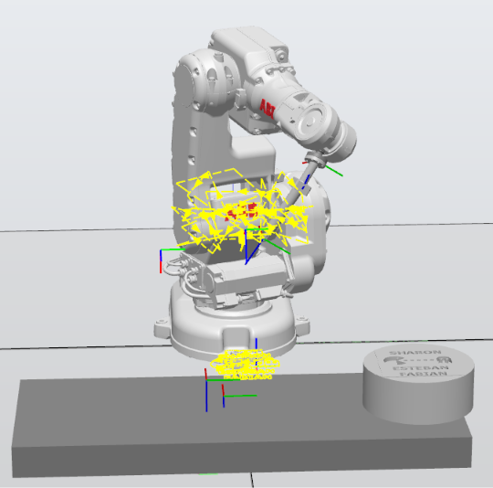
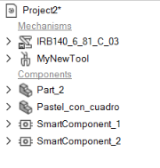
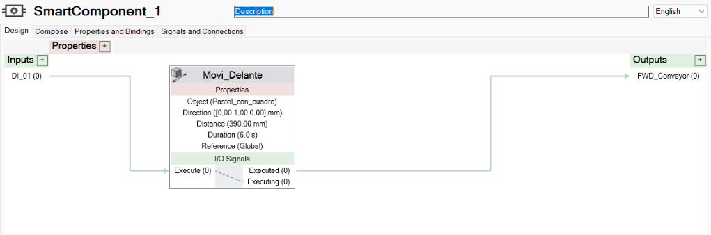
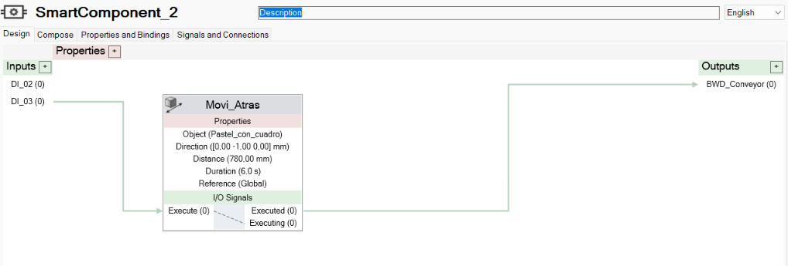

# RobotStudio

En esta carpeta se presenta la configuración de la estación desarrollada en **ABB RobotStudio** para la simulación del Laboratorio No. 01 de Robótica Industrial.

La estación integra el robot, el pastel, la geometría de la banda transportadora y los componentes necesarios para simular el desplazamiento del pastel.

## 1. Estación de RobotStudio

La estación fue construida en RobotStudio utilizando un robot **ABB IRB 140** y los diferentes elementos necesarios para representar el entorno de trabajo.

En la estación se encuentran los siguientes elementos principales:

- Robot ABB IRB 140.
- `Part_2`, utilizado como geometría de la banda.
- `Pastel_con_cuadro`, utilizado como objeto para la simulación.
- `SmartComponent_1`.
- `SmartComponent_2`.

La estación completa se puede observar en la siguiente imagen:



## 2. Estructura de la estación

En el árbol de la estación se pueden observar los mecanismos y componentes utilizados en la simulación.

Entre los elementos principales se encuentran el robot `IRB140_6_81_C_03`, la herramienta `MyNewTool`, la geometría `Part_2`, el pastel y los dos Smart Components utilizados para controlar su desplazamiento.



## 3. Banda transportadora

Para representar la banda transportadora se utilizó la geometría:

```text
Part_2
```

La geometría tiene las siguientes dimensiones:

| Parámetro | Valor |
|---|---:|
| Longitud | 1000 mm |
| Ancho | 400 mm |
| Altura | 72 mm |

Sobre esta geometría se configuró el sistema utilizado para simular el movimiento del pastel.

## 4. Smart Components

Para controlar el desplazamiento del pastel dentro de la simulación se utilizaron dos Smart Components.

Estos componentes permiten relacionar las señales digitales con el movimiento del objeto dentro de RobotStudio.

### 4.1 SmartComponent_1

El primer Smart Component se utiliza para realizar el movimiento hacia adelante.

La configuración realizada es:

```text
Entrada: DI_01

Objeto: Pastel_con_cuadro
Dirección: [0,0,1] 1000,00 mm
Distancia: 390,00 mm
Duración: 6,0 s
Referencia: Global

Salida: FWD_Conveyor
```

La entrada `DI_01` activa el movimiento definido en `Movi_Delante`, el cual desplaza el objeto `Pastel_con_cuadro` en la dirección configurada.



### 4.2 SmartComponent_2

El segundo Smart Component se utiliza para realizar el movimiento hacia atrás.

La configuración realizada es:

```text
Entradas: DI_02 y DI_03

Objeto: Pastel_con_cuadro
Dirección: [0,0,-1] 1000,00 mm
Distancia: 780,00 mm
Duración: 6,0 s
Referencia: Global

Salida: BWD_Conveyor
```

La entrada `DI_03` activa el movimiento definido en `Movi_Atras`, permitiendo desplazar el objeto en la dirección contraria.



## 5. Integración de los componentes

Los Smart Components permiten conectar las señales del sistema con los movimientos realizados dentro de RobotStudio.

De esta manera, la simulación relaciona las señales de entrada con el desplazamiento del pastel y las señales de salida utilizadas para representar el funcionamiento de la banda.

La configuración realizada permite simular el movimiento del pastel en ambas direcciones sin modificar manualmente su posición durante cada prueba.

## 6. Simulación

Una vez configurados los elementos de la estación, se realizaron pruebas de simulación para comprobar el desplazamiento del pastel sobre la banda.

Durante la simulación se verificó:

- La correcta ubicación del pastel sobre `Part_2`.
- El desplazamiento del pastel en la dirección de avance.
- El desplazamiento en la dirección contraria.
- La activación de los Smart Components mediante las señales correspondientes.
- La interacción entre los elementos de la estación.
