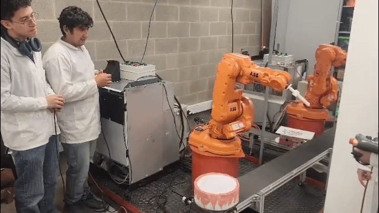
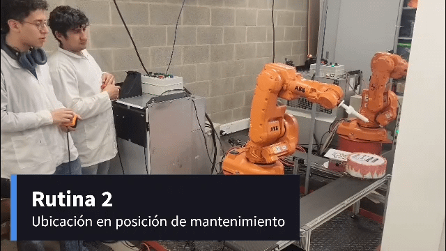
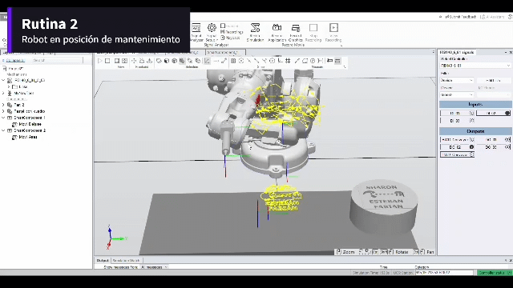
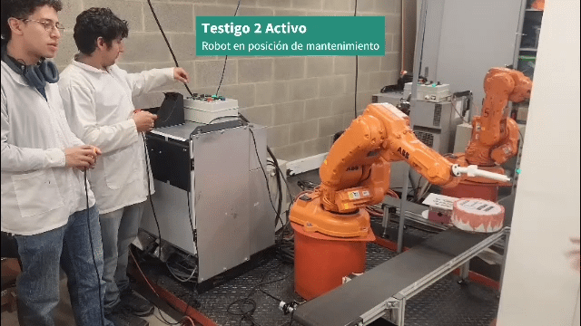
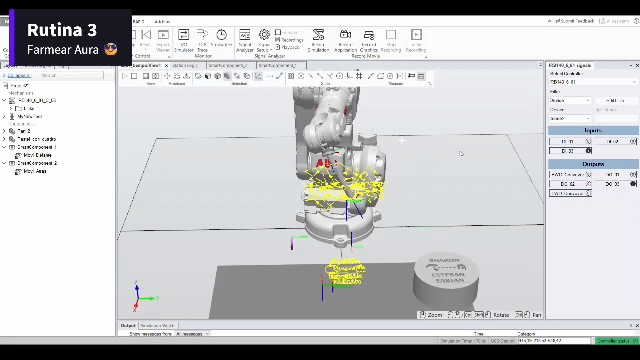
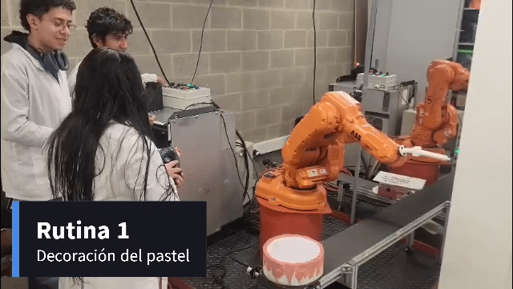
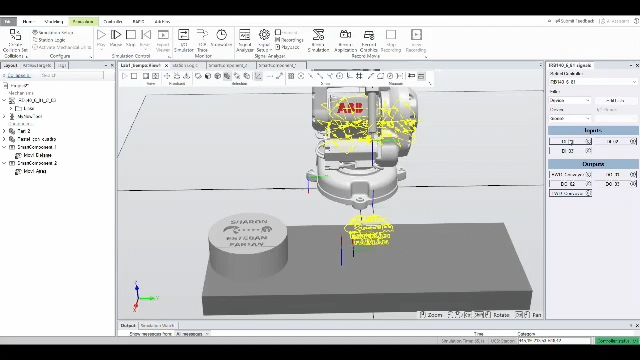
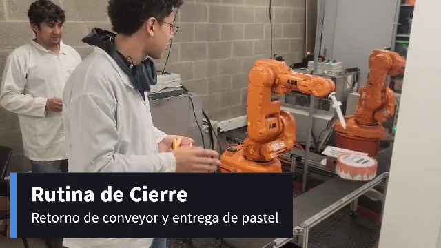
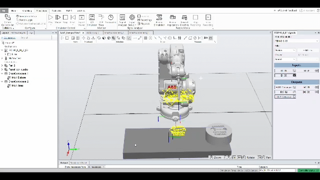

# Evidencias

## Evidencias de Funcionamiento I/O y Banda Transportadora

Documentación visual del funcionamiento del controlador ABB IRC5 mediante la activación de entradas digitales (sensores/pulsadores), salidas de indicación (testigos `DO`) y actuadores de la banda transportadora.

---

### 1. Entrada DI_01 y Salida DO_01 (Pulsador y Testigo 1)

**Descripción:** Al accionar el pulsador de la entrada digital `DI_01` inicia la rutina 1 de decorado de pastel, el controlador procesa la señal en tiempo real y conmuta la salida digital `DO_01`, encendiendo el piloto luminoso correspondiente.

| Entorno Real (Laboratorio) | Simulación (RobotStudio) |
| :---: | :---: |
|  |  |

>

---

### 2. Entrada DI_02 y Salida DO_02 (Pulsador y Testigo 2)

**Descripción:** Verificación del canal de entrada `DI_02` iniciando la rutina de mantenimiento del robot. La lectura correcta de esta señal en la rutina del programa RAPID dispara de forma inmediata la activación de la salida `DO_02`.

| Entorno Real (Laboratorio) | Simulación (RobotStudio) |
| :---: | :---: |
|  |  |

---

### 3. Entrada DI_03 y Salida DO_03 (Pulsador y Testigo 3)

**Descripción:** Enclavamiento y validación del tercer canal digital `DI_03` Iniciando la rutina de farmeo de aura, confirmando la respuesta de la salida `DO_03` tanto en la celda virtual como en el tablero físico del robot.

| Entorno Real (Laboratorio) | Simulación (RobotStudio) |
| :---: | :---: |
|  |  |

---

### 4. Avance de la Banda Transportadora (`FWD_Conveyor`)

**Descripción:** Activación de la salida digital encargada del giro del motor de la banda transportadora en sentido directo (`Forward`), moviendo la pieza de trabajo hacia el área de pintado/escritura del robot.

| Entorno Real (Laboratorio) | Simulación (RobotStudio) |
| :---: | :---: |
|  |  |

---

### 5. Retroceso de la Banda Transportadora (`BWD_Conveyor`)

**Descripción:** Maniobra de inversión de marcha (`Backward`) de la banda transportadora, utilizada para salida de producto terminado.
| Entorno Real (Laboratorio) | Simulación (RobotStudio) |
| :---: | :---: |
|  |  |

